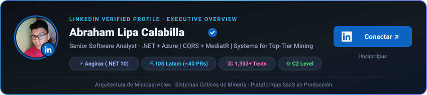

# Abraham Lipa Calabilla
### **Senior Software Analyst · Backend Architecture & Distributed Systems**

  
  
  

  
  
  
  
  
  

  

---

### ⚡ Blueprint Arquitectónico & Perfil Ejecutivo

Ingeniero y desarrollador backend con **3+ años full-time** (2+ en .NET), especializado en el diseño de microservicios de alto rendimiento, plataformas SaaS en vivo y sistemas de misión crítica:

- **Aegirax (Operación Técnica en Vivo):** Único responsable de código, arquitectura y operación de un producto SaaS en **.NET 10 / C# 12** con Clean Architecture, DDD, Event Sourcing y despliegue serverless en GCP.
- **Liderazgo Técnico en Minería (IDS Latam):** Referente para 5+ ingenieros, code review diario de **~40 PRs/semana**, definición de estándares y autorización multi-tenant para ~100 roles.
- **Patrones Enterprise & Políglota:** CQRS con **Wolverine** y **MediatR**, Event Sourcing con **Marten**, persistencia relacional optimizada (SQL Server, PostgreSQL, MariaDB/MySQL) y servicios en **PHP (Laravel)** y **Python (Django)**.
- **Cultura de Calidad & Resiliencia:** **1,353 tests** con xUnit y Testcontainers; observabilidad con **OpenTelemetry (OTLP)** y gobernanza spec-driven (127 planes, 26 ADRs).

---

### 🚀 Sistemas Principales en Producción

#### 1. ⚡ Aegirax — Plataforma SaaS en Producción (Proyecto Propio)
> *Operación técnica continua como único responsable de código, arquitectura, confiabilidad y despliegue.*

<table border="0">
  <tr>
    <td width="36%" valign="top" align="center">
      
        
      
        
      

        <b>🛠️ Stack Tecnológico:</b> 
        <code>.NET 10</code> · <code>C# 12</code> · <code>Wolverine</code> · <code>Marten (Event Sourcing)</code> · <code>PostgreSQL</code> · <code>Redis</code> · <code>Keycloak (OIDC/JWT)</code> · <code>GCP Cloud Run</code> · <code>Docker (Multi-stage)</code> · <code>GitHub Actions (WIF)</code> · <code>OpenTelemetry (OTLP)</code> · <code>xUnit</code> · <code>Testcontainers</code> · <code>Expo (React Native)</code>
      

    </td>
    <td width="64%" valign="top">
      <ul>
        <li><b>Arquitectura Hexagonal & DDD:</b> Microservicios en <b>.NET 10 / C# 12</b> estructurados en <b>5 Bounded Contexts</b>, Clean Architecture estricta, desacoplamiento de frameworks, value objects tipados con Vogen y validación con FluentValidation.</li>
        <li><b>CQRS & Event Sourcing Avanzado:</b> Implementado con <b>Wolverine + Marten</b> sobre <b>PostgreSQL</b>, aislando mutaciones transaccionales mediante streams de eventos inmutables de dominio.</li>
        <li><b>Identidad & Caché Distribuido:</b> Autenticación y autorización federada con <b>Keycloak (OIDC / JWT multi-tenant)</b> con resolución dinámica de claims por tenant y <b>Redis</b> como caché distribuido.</li>
        <li><b>Infraestructura Cloud Serverless (GCP):</b> Despliegue automatizado de <b>8 microservicios en Google Cloud Run</b> con Cloud Build, Artifact Registry, Pub/Sub, Docker multi-stage y <b>GitHub Actions vía Workload Identity Federation (WIF)</b>, sin credenciales estáticas en repositorios. DNS y protección perimetral en Cloudflare.</li>
        <li><b>Testing Exhaustivo:</b> Suite automatizada de <b>1,353 tests</b> (unitarios, integración y arquitectura) con xUnit, FluentAssertions, Respawn, Verify y <b>Testcontainers</b> ejecutados contra contenedores reales de PostgreSQL y Redis.</li>
        <li><b>Observabilidad & Gobernanza Spec-Driven:</b> Instrumentación con <b>OpenTelemetry (OTLP)</b> y Cloud Logging (identificando 10+ incidencias reales y optimizando memoria y cold start); ingeniería guiada por <b>127 planes ejecutados, 26 ADRs</b>, libro de deuda técnica con ciclo de vida (<b>224 deudas cerradas</b>) y gate de biblioteca anclado por hash.</li>
        <li><b>App Móvil:</b> Desarrollada con <b>Expo SDK (React Native)</b>, TypeScript, expo-router y NativeWind, con builds EAS listas para publicación.</li>
      </ul>
    </td>
  </tr>
</table>

---

#### 2. 🏢 IDS Latam — Senior Software Analyst
> *Sistemas de misión crítica para empresas mineras de primer nivel en el Perú.*

<table border="0">
  <tr>
    <td width="36%" valign="top" align="center">
      
        
      
        
      

        <b>🛠️ Stack Tecnológico:</b> 
        <code>.NET 8</code> · <code>C#</code> · <code>ASP.NET Core MVC</code> · <code>MediatR (CQRS)</code> · <code>Entity Framework Core</code> · <code>SQL Server (Stored Procedures & Triggers)</code> · <code>Azure SQL</code> · <code>Azure Service Bus</code> · <code>Azure Key Vault</code> · <code>Azure Functions</code> · <code>Azure App Insights</code> · <code>Azure DevOps</code> · <code>NSwag</code> · <code>React</code> · <code>Single SPA</code> · <code>Zustand</code> · <code>Python/Django</code>
      

    </td>
    <td width="64%" valign="top">
      <ul>
        <li><b>Liderazgo Técnico & Estándares:</b> Referente técnico para un equipo de <b>5+ ingenieros</b>: code review diario de <b>~40 PRs semanales</b> (rango de 5 a 100+), mentoría a desarrolladores junior y definición de buenas prácticas transversales.</li>
        <li><b>Arquitectura Backend & 12 Módulos Core:</b> Diseño de APIs REST y microservicios con <b>.NET 8 / C#</b>, <b>CQRS sobre MediatR</b>, Repository Pattern y Dependency Injection en 12 módulos core (asistencia, control de acceso, afiliación de personas, vehículos, seguros internos, autorizaciones, gestión SOMMA, contratos, administración, entrenamiento y movilización).</li>
        <li><b>Autorización Multi-Tenant E2E:</b> Implementación de extremo a extremo para <b>~100 roles y 8 clientes corporativos</b>: roles en base de datos, filtrado multi-tenant (<code>IHasCustomer</code> / <code>IHasCuenta</code>) y caché distribuido de 15 minutos con invalidación inmediata.</li>
        <li><b>Mensajería Asíncrona Resiliente:</b> Integración con <b>Azure Service Bus</b> (colas y topics) en 4 áreas de negocio (autorización, contratos, vehículos y seguros internos) con idempotencia y reintentos automáticos.</li>
        <li><b>Optimización de Persistencia & Carga:</b> Mitigación de problemas N+1 en SQL Server con <code>AsNoTracking</code> y <code>AsSplitQuery</code>, operaciones batch con <code>ExecuteUpdate</code>/<code>ExecuteDelete</code> y <code>BulkExtensions</code>. <b>Reducción de 50% a 80% en latencia</b> en reportes masivos de 10,000+ filas y consultas frontend.</li>
        <li><b>Operación Cloud en Azure:</b> Despliegue en 2 regiones y 6 tenants usando Azure App Service, Azure Functions (notificaciones serverless), Azure SQL, Key Vault (secretos rotados vía RBAC), Azure AD (OpenIdConnect) y App Insights.</li>
        <li><b>Generador de Clientes HTTP (NSwag):</b> Creación de un generador de clientes tipados en .NET y TypeScript consumidos con SWR, que expuso y corrigió 50+ APIs desactualizadas por diferencias de contratos.</li>
        <li><b>Servicios Auxiliares & Frontend:</b> Desarrollo de servicios auxiliares en <b>Node.js</b> y <b>Python (Django / DRF)</b>; frontend con React + Zustand + microfrontends (<b>Single SPA</b>) y Angular 2.x+ en paralelo.</li>
      </ul>
    </td>
  </tr>
</table>

---

#### 3. 🏨 Arenas Hotel & Spa — Property Management System (PMS)
> *Sistema integral de gestión hotelera, resort, spa y restaurante llevado de cero a producción sin equipo dedicado.*

<table border="0">
  <tr>
    <td width="36%" valign="top" align="center">
      
        
      
        
      

        <b>🛠️ Stack Tecnológico:</b> 
        <code>PHP</code> · <code>Laravel</code> · <code>Python (Django)</code> · <code>MariaDB / MySQL</code> · <code>Stored Procedures & Triggers</code> · <code>Impresión Térmica ESC/POS (Red)</code> · <code>FPDF (Reportes)</code> · <code>JWT Auth</code> · <code>JavaScript ES6+</code> · <code>Bootstrap</code> · <code>Git</code>
      

    </td>
    <td width="64%" valign="top">
      
<b>Dominios de Negocio & Módulos Desarrollados:</b>

      <ul>
        <li><b>🏨 Hospedaje & Front Desk (PMS Core):</b> Gestión de check-in / check-out con ficha de pasajero, control de acompañantes, rooming list, planilla de ocupación de habitaciones en tiempo real, housekeeping/mantenimiento, control diario de desayunos y <b>reporte oficial automatizado para MINCETUR</b> (declaración mensual de arribos y pernoctaciones).</li>
        <li><b>💆 Spa & Bienestar (Wellness):</b> Registro y admisión de clientes al spa, gestión de terapeutas con asignación por habilidades profesionales (masajes, estética, hidroterapia), agenda de turnos/servicios, liquidación por comisiones de terapeuta y módulo integral de <b>Gift Cards</b> (emisión, control de saldo y canje).</li>
        <li><b>🍽️ Alimentos & Bebidas / Restaurante (F&B POS):</b> Punto de venta para toma de pedidos en mesas, monitor de cocina (KDS) con control de estados de comanda (en preparación, visto, entregado), enrutamiento e impresión automática en red hacia impresoras térmicas ESC/POS (cocina/bar) y <b>escandallo de recetas (BOM)</b> con deducción automática de insumos en inventario.</li>
        <li><b>💰 Tesorería, Facturación & Cuenta Maestra:</b> Modelo de <b>cuenta maestra unificada (<code>nro_registro_maestro</code>)</b> para consolidar cargos cruzados (habitaciones, consumos de restaurante y sesiones de spa en una sola cuenta al check-out), gestión de caja diaria por turnos (aperturas, arqueos y cierres), emisión de comprobantes electrónicos con integración <b>SUNAT</b> (Boletas, Facturas) y control de cuentas por cobrar/pagar.</li>
        <li><b>📦 Almacén, Compras & Kardex:</b> Control de inventario simple y valorado, registro de compras a proveedores, petitorios internos de reposición entre áreas y kardex valorizado de productos e insumos.</li>
      </ul>
    </td>
  </tr>
</table>

---

### 🛠️ Stack Tecnológico & Herramientas

  

 

<table width="100%">
  <tr>
    <td width="33%" valign="top">
      <h4><b>⚙️ Backend & Lenguajes</b></h4>
      <ul>
        <li><b>C# (.NET 8 / .NET 10):</b> ASP.NET Core, MVC, Identity</li>
        <li><b>PHP (Laravel):</b> APIs REST, MVC, Auth</li>
        <li><b>Python:</b> Django, Django REST Framework (DRF)</li>
        <li><b>Node.js & TypeScript</b></li>
        <li><b>CQRS:</b> MediatR & Wolverine</li>
        <li><b>Event Sourcing:</b> Marten sobre PostgreSQL</li>
        <li><b>Clean Architecture & DDD:</b> 5 Bounded Contexts</li>
        <li><b>NSwag:</b> Generador HTTP tipado (.NET/TS)</li>
      </ul>
    </td>
    <td width="33%" valign="top">
      <h4><b>☁️ Cloud & Persistencia</b></h4>
      <ul>
        <li><b>Microsoft Azure:</b> App Service, Service Bus, Key Vault, Functions, App Insights, Azure DevOps</li>
        <li><b>Google Cloud (GCP):</b> Cloud Run, Cloud Build, Pub/Sub, Artifact Registry</li>
        <li><b>Bases de Datos SQL:</b> SQL Server, PostgreSQL, <b>MariaDB / MySQL</b> (Stored Procedures, Triggers, Diagramas ER)</li>
        <li><b>ORMs:</b> EF Core (LINQ, AsSplitQuery, BulkExtensions) & Dapper</li>
        <li><b>Caché Distribuido:</b> Redis & In-Process Cache</li>
        <li><b>DevOps:</b> Docker (Multi-stage), GitHub Actions (WIF)</li>
      </ul>
    </td>
    <td width="33%" valign="top">
      <h4><b>🧪 Calidad & Frontend</b></h4>
      <ul>
        <li><b>Testing Backend:</b> xUnit, FluentAssertions, Testcontainers, Respawn, Verify</li>
        <li><b>Testing Frontend/E2E:</b> Jest, Playwright</li>
        <li><b>Observabilidad:</b> OpenTelemetry (OTLP), Cloud Logging</li>
        <li><b>Frontend Web:</b> React, TypeScript, Zustand, SWR, Next.js, Angular 2.x+</li>
        <li><b>Microfrontends:</b> Single SPA</li>
        <li><b>Mobile:</b> React Native, Expo SDK, expo-router</li>
        <li><b>Gobernanza:</b> 127 Planes SDD, 26 ADRs, Roslynator</li>
      </ul>
    </td>
  </tr>
</table>

---

### 📈 Actividad y Contribuciones

  <table border="0">
    <tr>
      <td width="50%" align="center" valign="middle">
        
      </td>
      <td width="50%" align="center" valign="middle">
        
      </td>
    </tr>
  </table>

